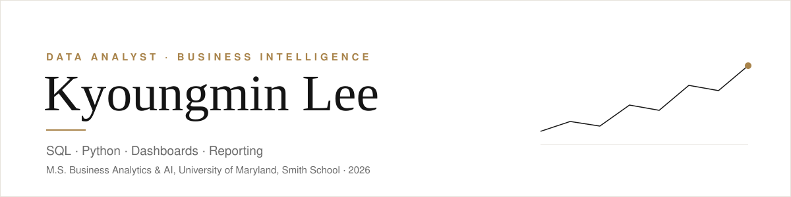
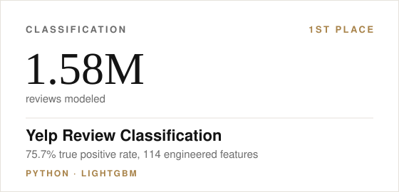
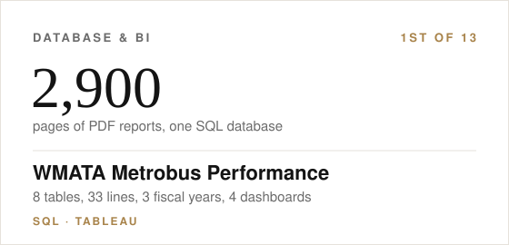
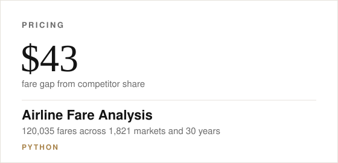
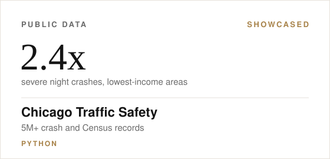
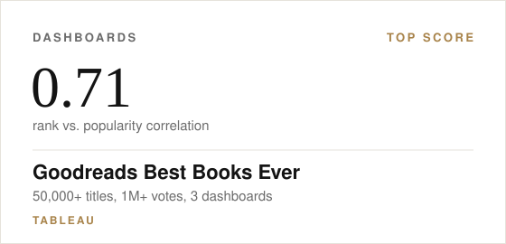
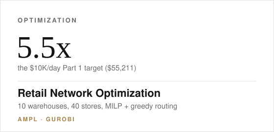
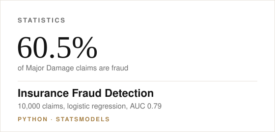
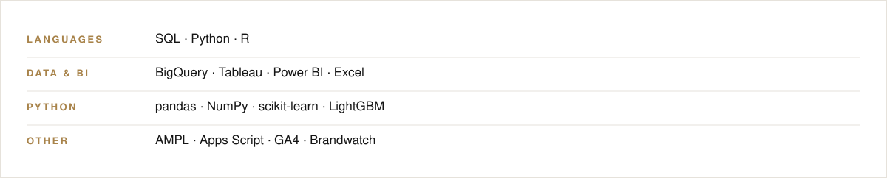

  <a href="https://www.kyoungminleeportfolio.com/">Portfolio</a> ·
  <a href="https://www.linkedin.com/in/kyoungmin-lee-89b762257">LinkedIn</a>

I build SQL data models, dashboards, and reports that help teams make decisions.
Co-author in the *Journal of Retailing and Consumer Services* (Elsevier, 2027). GA4 certified.

### Projects

  
  

  
  

  
  

  

### Stack

